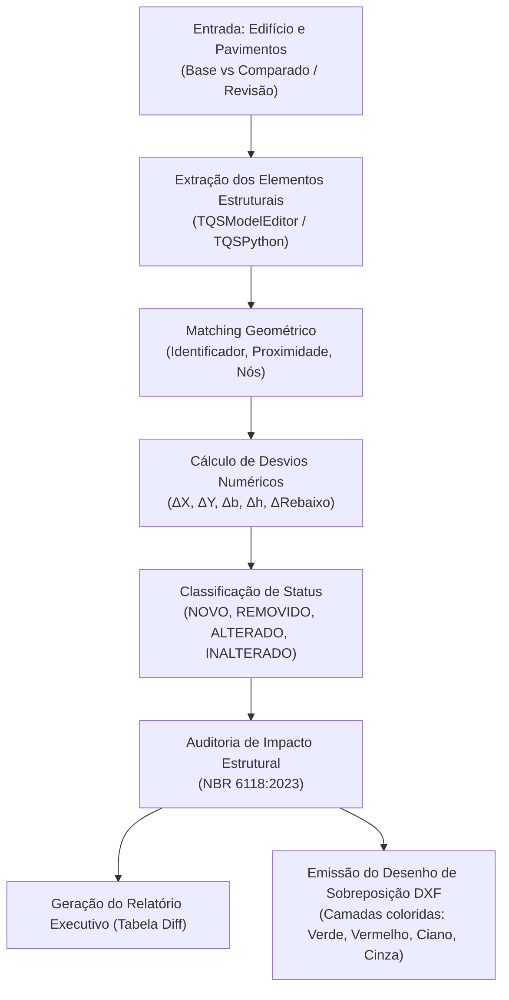

# Comparação de Geometrias e Plantas de Formas no TQS V25

Esta habilidade capacita o agente a realizar auditorias analíticas e gráficas completas entre arquivos de geometria (referências arquitetônicas DWG/DXF, revisões anteriores ou backups) e as Plantas de Formas / Modelador Estrutural do TQS V25.

---

## 🎯 Quando Utilizar Esta Skill

Ative esta habilidade sempre que o usuário solicitar:
1. **Comparar geometrias com a planta de formas**: Verificar se o lançamento estrutural no TQS está fiel à arquitetura de referência.
2. **Verificar o que alterou no software**: Auditar as diferenças entre duas revisões do modelo estrutural (ex: Revisão R00 vs R01, ou antes e depois de alterações no Modelador Estrutural).
3. **Auditar transições entre pavimentos**: Comparar as formas de pavimentos adjacentes (ex: `TIPO A` vs `TIPO B` ou `1º PAVIMENTO` vs `TÉRREO`) para identificar transições e desalinhamentos de pilares.
4. **Gerar prancha comparativa de sobreposição (Diff DXF)**: Emitir um desenho com código de cores destacando em tempo real todas as inclusões, exclusões e modificações.

---

## 🔍 O Que a Skill Analisa

A comparação examina três níveis fundamentais da modelagem de formas:

| Categoria | Parâmetros Comparados | Tolerância Padrão | Impacto Estrutural Avaliado |
| :--- | :--- | :--- | :--- |
| **🏛️ Pilares** | Coordenadas $(X, Y)$, Dimensões $(b, h)$, Área ($A_c$), Rotação | $\Delta \text{Pos} \le 5\text{ mm}$<br/>$\Delta b, h \le 5\text{ mm}$ | Excentricidades de carga, continuidade vertical, cálculo de fundações e esbeltez $\lambda$. |
| **🧱 Vigas** | Largura $b$, Altura $h$, Rebaixo/Desnível, Traçado dos nós | $\Delta b, h \le 5\text{ mm}$<br/>$\Delta \text{reb} \le 5\text{ mm}$ | Inércia à flexão ($EI$), flechas, armaduras longitudinais/transversais e apoio de lajes. |
| **🔲 Lajes** | Espessura $h$, Desnível/Rebaixo, Aberturas/Shafts | $\Delta h \le 5\text{ mm}$<br/>$\Delta \text{reb} \le 5\text{ mm}$ | Peso próprio permanente, rigidez da grelha de lajes e áreas molhadas. |

---

## 🚀 Fluxo de Execução Passo a Passo



### Passo 1: Identificar os Edifícios e Pavimentos
- Se o usuário mencionar um único edifício e pavimento, compare contra a versão anterior (backup na pasta do edifício, ex: `_BKP_*`, pastas de datas como `270626`, `041025`) ou entre pavimentos diferentes (ex: `TIPO A` vs `TIPO B`).
- Se o usuário especificar dois edifícios (ex: `"049"` e `"049_TESTE"`), compare o mesmo pavimento entre os dois projetos.

### Passo 2: Executar a Comparação
Execute a ferramenta nativa via terminal ou script Python:

```bash
# Opção A: Executar via CLI do AUTQS
python -m src.ui.cli --edificio "049" --pavimento "terreo" --comparar-formas

# Opção B: Comparar entre dois edifícios (ex: Original vs Revisão)
python -m src.ui.cli --edificio "049" --edificio-comp "049_TESTE" --pavimento "terreo" --comparar-formas

# Opção C: Comparar pavimentos diferentes no mesmo edifício
python -m src.ui.cli --edificio "054" --pavimento "tipo a" --pavimento-comp "tipo b" --comparar-formas

# Opção D: Script dedicado da skill
python .agents/skills/comparar-geometria-formas/scripts/comparar.py --base "049" --pav-base "terreo"
```

### Passo 3: Analisar e Apresentar os Resultados
Apresente ao usuário o relatório estruturado em tabela Markdown contendo:
- Total de novos elementos adicionados.
- Total de elementos excluídos/removidos.
- Total de elementos modificados com seus deltas quantitativos exatos ($\Delta X, \Delta Y, \Delta b, \Delta h$).
- Avaliação técnica do impacto estrutural conforme NBR 6118.
- Caminho do desenho vetorial de sobreposição gráfica gerado.

---

## 🎨 Código de Cores Oficial do Desenho de Sobreposição (Diff DXF)

O arquivo de desenho gerado (`DIFF_FORMAS_*.DXF`) utiliza layers e cores padronizadas da engenharia:

| Layer | Cor AutoCAD / TQS | Significado | Exemplo Visual |
| :--- | :--- | :--- | :--- |
| `DIFF_NOVO` | 🟢 **Verde** (Color 3) | Elemento novo adicionado no software | Novo pilar ou viga inserida no lançamento |
| `DIFF_REMOVIDO` | 🔴 **Vermelho** (Color 1) | Elemento removido / posição anterior | Elemento que existia na base e foi excluído |
| `DIFF_ALTERADO` | 🔵 **Ciano** (Color 4) | Elemento modificado | Pilar que mudou de dimensão ou posição |
| `DIFF_INALTERADO`| ⚪ **Cinza Claro** (Color 8)| Elemento sem alteração | Fundo de referência estrutural |
| `DIFF_TEXTOS` | ⚪ **Branco** (Color 7) | Cotas e anotações dos deltas ($\Delta$) | Textos com `Δb`, `Δh`, `ΔX`, `ΔY` |
| `DIFF_LEGENDA` | 🟡 **Amarelo** (Color 2) | Carimbo técnico e notas normativas | Selo explicativo no canto da prancha |

---

## 🛡️ Guardrails e Verificações Normativas (NBR 6118:2023)

Sempre que a comparação detectar alterações, alerte o engenheiro sobre as seguintes regras:
1. **Translação de Pilares ($\Delta X, \Delta Y > 0$):**
   - Gera excentricidade acidental adicional nas fundações e vigas de transição.
   - Exige verificação da continuidade das barras longitudinais e comprimento de traspasse.
2. **Redução de Altura de Viga ($\Delta h < 0$):**
   - A inércia cai com o cubo da altura ($I = b h^3 / 12$). Uma redução de $10\text{ cm}$ pode dobrar a flecha imediata e diferida no tempo.
3. **Aumento de Cargas / Espessuras de Lajes ($\Delta h > 0$):**
   - Cada centímetro adicional de concreto armado adiciona $25\text{ kgf/m}^2$ de peso próprio permanente na estrutura.
4. **Eliminação de Vigas de Apoio:**
   - Transforma vãos simples em lajes contínuas ou balanços, exigindo recálculo imediato da grelha de lajes.
