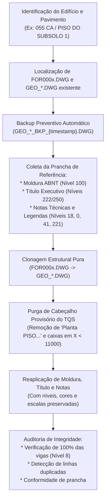

# Geração de Geometria Executiva de Concreto Armado (TQS CA)

Esta habilidade automatiza a montagem da prancha executiva oficial de **Geometria / Pré-Geometria de Formas** (`GEO_<PAVIMENTO>.DWG`) a partir do arquivo estrutural processado pelo Modelador Estrutural do TQS (`FOR000x.DWG`).

---

## 🎯 Quando Utilizar Esta Skill

Ative esta habilidade sempre que o usuário solicitar:
1. **"Faça a geometria do <pavimento> do <edifício>"**: Ex: Subsolo 1, Térreo, Tipo ou Cobertura em edifícios de Concreto Armado (`CA`).
2. **"Atualize a prancha de formas / GEO"**: Quando o usuário alterou o `Modelo.DWG` e reprocessou as formas, necessitando atualizar o `GEO_*.DWG` oficial mantendo moldura e notas.
3. **"Monte a geometria com a moldura e notas técnicas"**: Integrar a nova malha de vigas, pilares e lajes com a folha padrão ABNT (Moldura 180-70, Nível 100).

---

## 🏗️ Pipeline de Engenharia



---

## 🚀 Como Executar

### Via Python API
```python
from src.skills.case_13_geometria_ca.skill import GeometriaCASkill

skill = GeometriaCASkill()
resultado = skill.executar(
    edificio_nome="055",
    pavimento="PISO DO SUBSOLO 1",
    escala=50
)

print(f"Status: {resultado['status']}")
print(f"Arquivo gerado: {resultado['caminho_geo']}")
print(f"Vigas auditadas: {resultado['auditoria']['total_vigas']}")
```

### Validações de Qualidade Automáticas
O método `validar()` garante:
1. Existência física do arquivo `GEO_*.DWG` com tamanho válido (> 10 KB).
2. Presença íntegra da Moldura ABNT no Nível 100.
3. Fidelidade total da malha estrutural (vigas no Nível 8 e contornos no Nível 235).
4. Zero conflitos ou sobreposições espaciais entre notas técnicas ($Y \ge -2350$) e a estrutura ($Y < -2350$).
