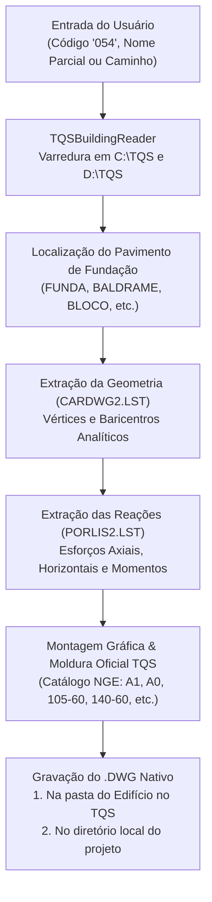

# AUTQS — Plataforma de IA Autônoma para TQS V25

O **AUTQS** é uma plataforma inovadora que integra agentes autônomos de Inteligência Artificial ao ecossistema do software **TQS V25** através da biblioteca nativa `TQSPythonInterface` (64-bit).

A plataforma foi desenvolvida para automatizar processos de engenharia estrutural de ponta a ponta: extração de dados, cálculo de baricentros analíticos, leitura de esforços de pórtico espacial, emissão de pranchas em **.DWG nativo** e suporte a consultas técnicas via **Chat com IA Generativa**.

---

## 📑 Sumário
1. [Principais Recursos](#-principais-recursos)
2. [Universalidade: Como Funciona para Qualquer Edifício](#-universalidade-como-funciona-para-qualquer-edifício)
3. [Extração Oficial de Cargas (Padrão PORLID)](#-extração-oficial-de-cargas-padrão-porlid)
4. [Interfaces de Chat e Uso](#-interfaces-de-chat-e-uso)
   - [Opção 1: Interface Web Visual (Streamlit)](#opção-1-interface-web-visual-streamlit)
   - [Opção 2: Chat no Terminal (CLI)](#opção-2-chat-no-terminal-cli)
   - [Opção 3: Comandos Rápidos de Linha de Comando](#opção-3-comandos-rápidos-de-linha-de-comando)
5. [Modelo de IA Integrado (Google Gemini Gratuito)](#-modelo-de-ia-integrado-google-gemini-gratuito)
6. [Estrutura do Projeto e Arquivos de Referência](#-estrutura-do-projeto-e-arquivos-de-referência)
7. [Requisitos do Sistema](#-requisitos-do-sistema)


---

## 🚀 Principais Recursos

- **Extração Paramétrica Automática**: Identifica todos os pilares que nascem no pavimento de fundação (sejam 4 ou mais de 150 pilares).
- **Cálculo Analítico de Baricentros ($X_{cg}, Y_{cg}$)**: Integração exata de polígonos fechados (fórmula de Gauss/Shoelace) para seções retangulares, quadradas, em "L", "T" ou qualquer formato poligonal.
- **Leitura Real de Esforços do Pórtico Espacial**: Extrai $N_k, F_x, F_y, M_x, M_y$ para cada pilar a partir dos relatórios vetoriais (`PORLIS2.LST`).
- **Geração de .DWG Nativo Binário (AC1006)**: Utiliza a tecnologia `TQSDwg` para produzir pranchas oficiais com todos os níveis de penas, fontes, estilos e cores padrão do TQS.
- **Diagramação e Molduras Inteligentes**: Seleciona automaticamente o menor formato catalogado oficial do TQS (`D:\TQSW\SUPORTE\NGE\MOLDURAS`: A2, A1, A0, 105-60, 140-60, 150-70, etc.) em escala 1:50, com margem de encadernação de 25 mm e área reservada para o selo/carimbo da empresa.
- **Anti-Colisão de Textos**: Rótulos e dimensões posicionados fora do polígono dos pilares, com detecção automática de pilares gêmeos em juntas de dilatação (< 65 cm).

---

## 🌐 Universalidade: Como Funciona para Qualquer Edifício

O AUTQS é **completamente agnóstico** ao projeto. Você pode solicitar a planta de cargas de qualquer obra:



### Como o leitor encontra seu edifício:
1. **Por código numérico**: `054`, `049`, etc.
2. **Por nome ou substring**: `"Visconde"`, `"Camboatés"`, `"Torre A"`.
3. **Por caminho absoluto**: `C:\TQS\Meu_Edificio` ou qualquer pasta de rede.

> [!NOTE]
> **Pré-requisito no TQS**: Para edifícios de concreto armado, o edifício precisa ter sido calculado pelo menos uma vez no TQS (**Processamento Global** ou **Pórtico Espacial**) para que o TQS gere os arquivos da pasta `ESPACIAL` (`CARDWG2.LST`, `PORLIS2.LST` e `PORLID.DWG`). Caso contrário, o sistema emite um diagnóstico explicando a ação necessária.

---

## 📊 Extração Oficial de Cargas (Padrão PORLID Universal)

A tabela de cargas gerada pelo AUTQS é **100% idêntica ao relatório e prancha oficial do TQS (`PORLID.DWG` e `GEO_CARGAS.DWG`)** gerado na pasta `ESPACIAL`.

### 1. O que é o PORLID no TQS?
No TQS, a emissão da tabela de cargas nas fundações é controlada pela tarefa batch **`TaskLoadsReport`** (Script `PORLID`, Task ID 4, implementada em `TQSExec.py`).
- Quando o engenheiro solicita a planta de cargas ou relatório de cargas no TQS (menu *Pórtico Espacial > Cargas nas Fundações > Planta de Cargas*), o programa `FPORLID.EXE` processa as envoltórias do modelo estrutural.
- As combinações críticas ativas são configuradas no arquivo `PORLID3.DAT` de cada edifício. Dependendo do projeto, o edifício pode ter configurado:
  - **1 Caso Crítico**: (ex: `Visconde do Herval 054` com `CASO 1 - FZ MAX`).
  - **Múltiplos Casos Críticos**: (ex: `Jardim Europa 055` com **6 casos**: `FZ MAX`, `MX MAX`, `MY MAX`, `FZ MIN`, `MX MIN`, `MY MIN`).
- O TQS gera `ESPACIAL/PORLID.TXT` (exportação tabulada) e `ESPACIAL/PORLID.DWG` (desenho vetorial) contendo todos os casos ativos.

### 2. Estrutura Oficial de 7 Componentes por Caso:
Diferente de tabelas simplificadas, cada bloco de caso contém rigorosamente **7 colunas**:
1. **`PILAR / Elem`**: Identificador do elemento de fundação (`P1`, `P1014`, `B1`, `PC2`, etc.).
2. **`Fz (tf)`**: Força vertical axial atuante (compressão/tração).
3. **`Fx (tf)`**: Força horizontal na direção do eixo global X.
4. **`Fy (tf)`**: Força horizontal na direção do eixo global Y.
5. **`Mx (tfm)`**: Momento fletor em torno do eixo X.
6. **`My (tfm)`**: Momento fletor em torno do eixo Y.
7. **`Mz (tfm)`**: Momento torsor / em torno do eixo Z.

### 3. Como o AUTQS Opera Dinamicamente:
- O módulo **`TQSPorlidReader`** (`src/tqs_adapter/porlid_reader.py`) lê dinamicamente todos os casos de `ESPACIAL/PORLID.TXT` (estratégia primária rápida e exata) com fallback transparente para parsing vetorial de `ESPACIAL/PORLID.DWG`.
- Detecta o número exato de combinações ativas ($1, 2, 4, 6\dots$) e os dados de cada elemento para cada combinação.
- O construtor gráfico **`TQSDwgPlantaDeCargasBuilder`** desenha a tabela adaptada:
  - **Múltiplos Casos**: desenha todos os blocos de casos lado a lado (ex: 6 blocos paralelos), com cada pilar alinhado na mesma linha horizontal através de todos os casos (exatamente como em `GEO_CARGAS.DWG`).
  - **Caso Único**: auto-dimensiona em 2 colunas paralelas compactas para economizar espaço de folha.
  - **Observações Detalhadas**: a seção de notas lista automaticamente a descrição e fórmula de cada caso crítico presente.

---


## 💬 Interfaces de Chat e Uso

### Opção 1: Interface Web Visual (Streamlit)
A forma mais rica e intuitiva para o engenheiro interagir com o projeto.

#### Como iniciar:
Dê um **duplo clique** no arquivo:
👉 `autqs-chat.bat`

*(Ou no terminal: `.\autqs-chat.bat`)*

O sistema abrirá automaticamente o navegador em `http://localhost:8501`.

#### O que você encontra na Interface Web:
- **Chat Interativo**: Digite perguntas como:
  - *"Gere a planta de cargas do edifício 054"*
  - *"Quais são os 5 pilares com maior carga axial?"*
  - *"Tem algum pilar com esforço de tração?"*
  - *"Quais edifícios tenho disponíveis no TQS?"*
- **Barra Lateral com Seletor de Obras**: Lista todos os edifícios de `C:\TQS` e `D:\TQS` com status em tempo real (`● Pronto` ou `▲ Requer Processamento`).
- **Botões de Ação Rápida**: `📐 Gerar DWG`, `🏆 Top Cargas`, `⚠️ Ver Tração`, `🏢 Listar Obras`.
- **Mapa Interativo 2D (Plotly)**: Visualização da posição real dos pilares na fundação, com bolhas dimensionadas e coloridas conforme a carga axial $N_k$.
- **Tabela Dinâmica**: Tabela de pilares com ordenação por qualquer coluna, busca e resumo estatístico.
- **Download e Abertura em 1 Clique**: Baixe o arquivo `.DWG` ou clique em **"Abrir no Editor Gráfico TQS (EAGW)"**.

---

### Opção 2: Chat no Terminal (CLI)
Para quem prefere interagir direto pelo prompt de comando ou PowerShell sem abrir navegador:

```cmd
.\autqs.bat --chat
```

Exemplo de uso:
```text
=================================================================
   AUTQS AGENT - CHAT INTERATIVO DE ENGENHARIA ESTRUTURAL
=================================================================
Converse em linguagem natural com o TQS V25.
Digite 'sair' para encerrar a sessão.

[Engenheiro] > quais edificios tenho no TQS?
[AUTQS Agent]: Lista todos os edifícios e seu status de cálculo...

[Engenheiro] > gere a planta de cargas do edificio 054
[AUTQS Agent]: 🎯 Planta de Cargas gerada com 69 pilares em PLANTA_DE_CARGAS_054.dwg!

[Engenheiro] > sair
```

---

### Opção 3: Comandos Rápidos de Linha de Comando

Você também pode disparar comandos diretos pelo terminal:

```cmd
:: Listar todos os edifícios detectados no TQS
.\autqs.bat --listar

:: Gerar a planta de cargas de um edifício específico (DWG nativo)
.\autqs.bat --edificio 054
.\autqs.bat --edificio "Visconde do Herval"

:: Listar ferramentas (Tools/Function Calling) registradas no agente
.\autqs.bat --tools
```

---

## 🤖 Modelo de IA Integrado (Google Gemini Gratuito)

O AUTQS utiliza uma arquitetura híbrida de Inteligência Artificial:

| Modo | Modelo | Descrição |
| :--- | :--- | :--- |
| **IA Generativa (Nuvem)** | **Google Gemini 3.6 Flash** | Responde a dúvidas teóricas e conceituais de engenharia (NBR 6118, NBR 6122, estabilidade global, alívio de cargas, armaduras) e contextualiza as respostas com os dados do edifício ativo. |
| **Motor Estrutural Local** | **AUTQS Core Engine** | Despacha as chamadas das DLLs do TQS com 100% de exatidão matemática, calculando baricentros e reações sem risco de alucinação de números. |

### Configuração da Chave Gemini:
A chave é salva de forma segura no arquivo `.env` na raiz do projeto:
```env
GEMINI_API_KEY=sua_chave_aqui
```

- **Cota Gratuita:** 15 requisições por minuto e até 1.500 requisições por dia via [Google AI Studio](https://aistudio.google.com).
- **Sem consumo de hardware:** As consultas à IA não sobrecarregam sua placa de vídeo (GTX 1050 Ti), deixando seu computador 100% livre para o processamento do TQS.
- **Fallback Automático:** Caso um modelo da nuvem esteja instável, o sistema alterna automaticamente entre `gemini-3.6-flash`, `gemini-3.1-flash-lite` e `gemini-3.8-flash`.

---

## 📁 Estrutura do Projeto e Arquivos de Referência

```
Projeto AUTQS/
├── .env                         # Configurações de ambiente e chaves de API
├── autqs.bat                    # Atalho do CLI configurado para Python 64-bit
├── autqs-chat.bat               # Atalho executável da Interface Web Streamlit
├── GEO_CARGAS.DWG               # Template de referência oficial TQS (AC1006)
├── PLANTA_DE_CARGAS_054.DWG     # Desenho gerado nativo para o Edifício 054
├── src/
│   ├── agent/
│   │   ├── chat_agent.py        # Agente inteligente de conversação
│   │   ├── gemini_client.py     # Cliente resiliente da API Google Gemini
│   │   ├── orchestrator.py      # Orquestrador cognitivo e despacho de comandos
│   │   └── tools.py             # Registro de ferramentas (Function Calling)
│   ├── core/
│   │   └── models.py            # Modelos de domínio (Pilar, Baricentro, Esforços, PORLID)
│   ├── drawing/
│   │   ├── tqs_dwg_builder.py   # Construtor binário nativo TQS .DWG (AC1006 com tabela PORLID)
│   │   └── sheet_builder.py     # Fallback de desenho vetorial DXF
│   ├── reference/               # 📚 Arquivos oficiais da TQSPythonInterface (TQS V25)
│   │   ├── TQSBuild.py          # Dados de projeto e geometria do edifício
│   │   ├── TQSDwg.py            # Manipulador vetorial de arquivos DWG (desenho, iteração, penas)
│   │   ├── TQSEag.py            # Comandos de edição gráfica
│   │   ├── TQSExec.py           # Automação de tarefas em batch (TaskLoadsReport / PORLID)
│   │   ├── TQSGeo.py            # Primitivas geométricas (pontos, linhas, arcos)
│   │   ├── TQSModel.py          # Modelo numérico estrutural
│   │   └── ...                  # Demais módulos oficiais TQS
│   ├── skills/
│   │   └── case_01_planta_cargas/ # Habilidade da Planta de Cargas e Locação
│   │       ├── geometry.py      # Algoritmos analíticos de baricentro poligonal
│   │       └── skill.py         # Pipeline de execução do Caso 1
│   ├── tqs_adapter/
│   │   ├── building_reader.py   # Leitor universal de edifícios (CARDWG2, PORLIS2)
│   │   ├── porlid_reader.py     # Leitor nativo do relatório de cargas oficial (PORLID.DWG)
│   │   └── tqs_env.py           # Configuração de PATH e DLLs nativas 64-bit do TQS
│   └── ui/
│       ├── chat_app.py          # Aplicação Web Streamlit (Interface Visual com aba PORLID)
│       └── cli.py               # Interface de Linha de Comando (CLI & REPL Chat)
```


---

## 💻 Como Usar em Outros Computadores (Passo a Passo)

O AUTQS foi preparado para ser **100% portável**. Você pode clonar o repositório em qualquer computador com Windows e TQS instalado:

### 1. Clonar o Repositório
```bash
git clone <URL_DO_SEU_REPOSITORIO_GITHUB>
cd "Projeto AUTQS"
```

### 2. Instalar as Dependências Python
Certifique-se de usar o **Python 64-bit** (versão 3.10, 3.11 ou 3.12):
```bash
pip install -r requirements.txt
```
*(ou `py -3-64 -m pip install -r requirements.txt`)*

> [!NOTE]
> **Biblioteca TQS integrada:** O pacote oficial da biblioteca Python do TQS já está incluído dentro da pasta `src/reference/` com fallback automático. Mesmo se o TQS não tiver registrado o pacote no `site-packages` do seu Python, o sistema detecta e carrega automaticamente!

### 3. Configurar a Chave da IA (.env)
Copie o arquivo de exemplo `.env.example` para `.env`:
```bash
copy .env.example .env
```
Abra o arquivo `.env` e insira sua chave da API do Google Gemini (gratuita):
```env
GEMINI_API_KEY=sua_chave_aqui
```
*(Obtenha gratuitamente em [Google AI Studio](https://aistudio.google.com/)).*

### 4. Executar
Você pode rodar por qualquer uma das opções:
- **Interface Web de Chat (Dashboard no navegador):**
  Dê duplo clique em `autqs-chat.bat`
- **Linha de Comando (CLI):**
  Dê duplo clique em `autqs.bat` ou execute:
  ```bash
  autqs.bat --edificio 054
  autqs.bat --edificio "Jardim Europa"
  ```

---

## ⚙️ Requisitos do Sistema

- **Sistema Operacional:** Windows 10 ou 11 (64-bit).
- **TQS:** TQS V23, V24 ou V25 instalado em qualquer unidade de disco (`C:\TQSW`, `D:\TQSW`, `E:\TQSW`, etc.). O sistema detecta o caminho automaticamente via Registro do Windows ou varredura de discos.
- **Python:** Python 3.10+ de **64 bits** (obrigatório para compatibilidade com as DLLs x64 do TQS).
- **Dependências:** Listadas em `requirements.txt` (`streamlit`, `plotly`, `pandas`, `requests`, `python-dotenv`, `ezdxf`).

> [!TIP]
> Os inicializadores `autqs.bat` e `autqs-chat.bat` detectam automaticamente o interpretador Python 64-bit instalado no seu sistema (`py -3-64`, `Program Files` ou `AppData`), configuram o `PYTHONPATH` e iniciam a aplicação sem necessidade de configurações manuais.

